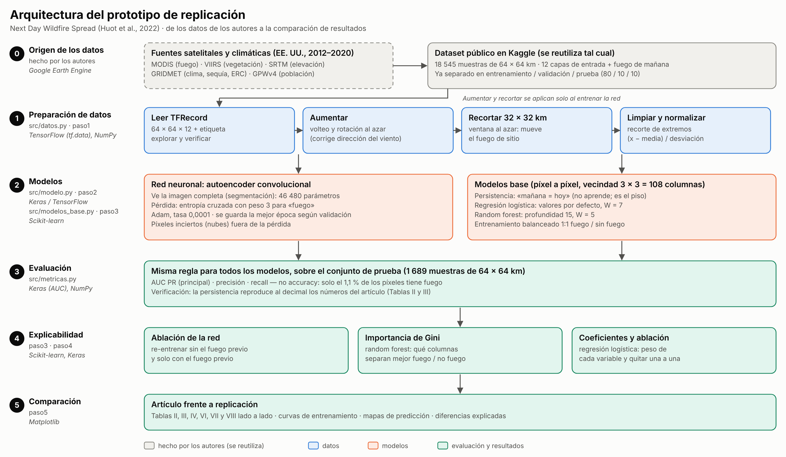
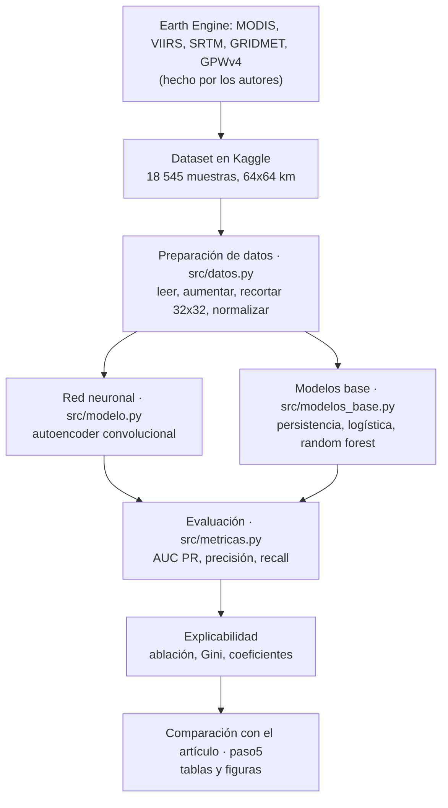
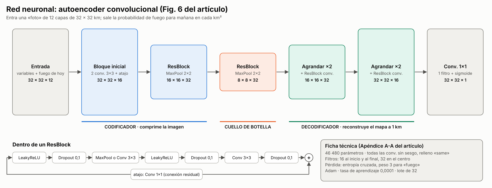
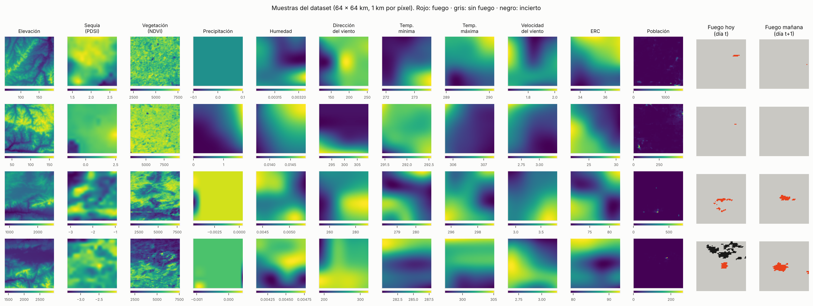
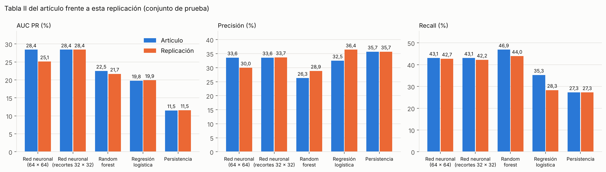
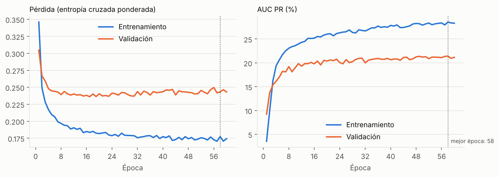
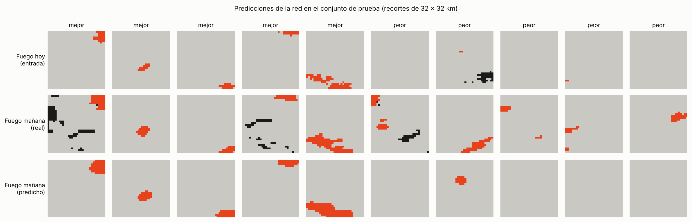
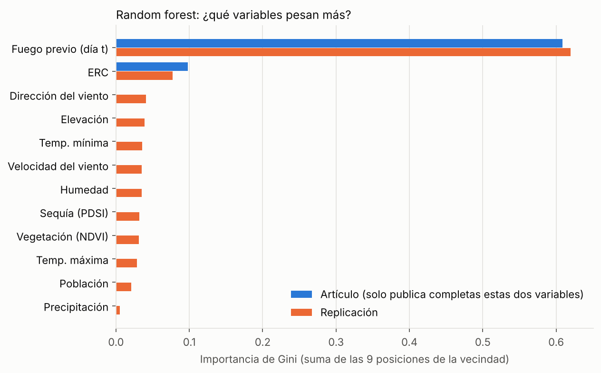

# Replicación de *Next Day Wildfire Spread* (Huot et al., 2022)

Documentación técnica de la replicación: qué investigó el artículo, cómo lo hizo, cómo se replicó y qué tan cerca quedaron los resultados.

## Contenido

1. [Resumen](#1-resumen)
2. [Análisis del artículo](#2-análisis-del-artículo)
3. [Flujo de trabajo de los autores y qué se replica](#3-flujo-de-trabajo-de-los-autores-y-qué-se-replica)
4. [Herramientas](#4-herramientas)
5. [Arquitectura del prototipo](#5-arquitectura-del-prototipo)
6. [Cómo ejecutar el prototipo](#6-cómo-ejecutar-el-prototipo)
7. [El código, archivo por archivo](#7-el-código-archivo-por-archivo)
8. [Resultados y comparación con el artículo](#8-resultados-y-comparación-con-el-artículo)
9. [Diferencias con el artículo y su efecto](#9-diferencias-con-el-artículo-y-su-efecto)
10. [Hallazgos de la replicación](#10-hallazgos-de-la-replicación)
11. [Relación con la tesis](#11-relación-con-la-tesis)
12. [Límites del prototipo y siguientes pasos](#12-límites-del-prototipo-y-siguientes-pasos)
13. [Referencias](#13-referencias)

---

## 1. Resumen

**Qué hace el artículo.** Los autores arman un dataset público de 18 545 incendios de EE. UU. (2012–2020) y entrenan una red neuronal que recibe el mapa del fuego de hoy junto con el clima, el terreno, la vegetación y la población, y dibuja dónde habrá fuego mañana. La comparan con una regresión logística, un random forest y la regla "mañana será igual que hoy" (persistencia).

**Qué hace este prototipo.** Repite ese flujo con el dataset que los autores publicaron en Kaggle: verifica los datos, entrena el mismo autoencoder convolucional y los mismos modelos base, repite parte del análisis de variables y pone cada resultado al lado del que reporta el artículo.

**Resultado principal** (conjunto de prueba, métricas en %):

| Modelo | Artículo (AUC PR / precisión / recall) | Replicación, muestra completa de 64 × 64 km | Replicación, recortes de 32 × 32 km |
| --- | --- | --- | --- |
| Red neuronal | 28,4 / 33,6 / 43,1 | 25,1 / 30,0 / 42,7 | 28,4 / 33,7 / 42,2 |
| Random forest | 22,5 / 26,3 / 46,9 | 21,7 / 28,9 / 44,0 | no medido |
| Regresión logística | 19,8 / 32,5 / 35,3 | 19,9 / 36,4 / 28,3 | no medido |
| Persistencia | 11,5 / 35,7 / 27,3 | 11,5 / 35,7 / 27,3 | 14,3 / 40,1 / 26,4 |

**Lectura en tres frases.**

1. **El orden y casi todos los valores se reproducen.** La red supera al random forest, este a la regresión logística y esta a la persistencia. La persistencia sale idéntica; el AUC PR de la regresión logística queda a 0,1 puntos y el del random forest a 0,8.
2. **El número de la red depende de sobre qué píxeles se mide.** Con el mismo protocolo que los modelos base (muestra completa) da 25,1; sobre recortes de 32 × 32 km da 28,4, el valor del artículo. El artículo no dice cuál usó para la red; la evidencia apunta a que midió la red sobre recortes y los modelos base sobre la muestra completa (sección 10).
3. **El fuego de hoy es la variable decisiva.** Sin él, el AUC PR de la red cae a 3,8 (6,9 sobre recortes; el artículo reporta 6,8) y el de la regresión logística a 3,1 (el artículo: 3,1).

---

## 2. Análisis del artículo

### 2.1 Ficha

| Campo | Detalle |
| --- | --- |
| Título | Next Day Wildfire Spread: A Machine Learning Dataset to Predict Wildfire Spreading From Remote-Sensing Data |
| Autores | Fantine Huot, R. Lily Hu, Nita Goyal, Tharun Sankar, Matthias Ihme y Yi-Fan Chen (Google Research; Ihme también en Stanford) |
| Revista | IEEE Transactions on Geoscience and Remote Sensing, vol. 60, 2022, Art. 4412513 |
| DOI | 10.1109/TGRS.2022.3192974 |
| Licencia | CC BY 4.0 |
| Código | https://github.com/google-research/google-research/tree/master/simulation_research/next_day_wildfire_spread |
| Datos | https://www.kaggle.com/datasets/fantineh/next-day-wildfire-spread |

### 2.2 Problema y motivación

- Los incendios forestales cuestan vidas, viviendas y emisiones: en 2019, más de 775 000 residencias de EE. UU. estaban en riesgo "extremo", y los incendios aportan cerca del 10 % del CO₂ mundial anual (Introducción).
- Saber dónde estará el fuego mañana sirve para decidir dónde enviar brigadas, a quién evacuar y qué líneas eléctricas apagar.
- **Vacío que detectan:** los datasets de incendios existentes (FRY, Fire Atlas, GlobFire, el catálogo de 1,88 millones de incendios de EE. UU., el de Canadá) dan el área quemada o puntos, pero ninguno junta mapas 2D del fuego con variables explicativas a 1 km, y los estudios que sí combinaron variables no publicaron sus datos (Tabla I).

### 2.3 Objetivo y contribuciones

**Objetivo:** construir y publicar un dataset que permita entrenar modelos de aprendizaje automático para predecir la propagación del fuego a un día, y demostrar que sirve entrenando un modelo.

**Contribuciones:**

1. El dataset "Next Day Wildfire Spread": 18 545 muestras de 64 × 64 km a 1 km, con 11 variables observadas, el fuego del día *t* y el fuego del día *t* + 1.
2. El código de Google Earth Engine que lo genera, para que otros lo adapten a otra región o período.
3. Una línea base: un autoencoder convolucional comparado con regresión logística, random forest y persistencia.
4. Un análisis de qué variables aportan más (ablación, importancia de Gini, coeficientes).

### 2.4 Diseño metodológico

| Aspecto | En el artículo |
| --- | --- |
| Enfoque | Cuantitativo |
| Tipo | Experimental: se entrenan modelos y se comparan con métricas sobre datos no vistos |
| Unidad de análisis | Un píxel de 1 km × 1 km dentro de una región de 64 × 64 km, en un día dado |
| Formulación | Segmentación de imágenes: cada píxel se clasifica como "fuego" o "sin fuego" para el día siguiente |
| Variable dependiente | Máscara de fuego del día *t* + 1 |
| Variables independientes | 11 variables observadas + máscara de fuego del día *t* |
| Validación | Partición entrenamiento / validación / prueba 8:1:1, por semanas al azar; la validación elige el modelo y la prueba lo mide |
| Línea base | Persistencia, regresión logística, random forest |

### 2.5 Datos

**Fuentes** (Sección II-B). Ninguna variable fue calculada por los autores; todas vienen de catálogos de Earth Engine.

| Variable | Nombre en el dataset | Fuente | Resolución original |
| --- | --- | --- | --- |
| Fuego hoy / mañana | `PrevFireMask` / `FireMask` | MODIS MOD14A1 V6 | 1 km, diaria |
| Elevación | `elevation` | SRTM | 30 m |
| Dirección y velocidad del viento | `th`, `vs` | GRIDMET | 4 km, diaria |
| Temperatura mínima y máxima | `tmmn`, `tmmx` | GRIDMET | 4 km, diaria |
| Humedad específica | `sph` | GRIDMET | 4 km, diaria |
| Precipitación | `pr` | GRIDMET | 4 km, diaria |
| Energy release component | `erc` | GRIDMET | 4 km, diaria |
| Sequía (índice de Palmer) | `pdsi` | GRIDMET Drought | 4 km, cada 5 días |
| Vegetación | `NDVI` | VIIRS VNP13A1 | 500 m, cada 8 días |
| Densidad de población | `population` | GPWv4 | 1 km, cada 5 años |

**Cómo se arma cada muestra** (Sección II-C y `data_export/export_ee_data.py`):

1. Para cada día entre 2012 y 2020, sobre el rectángulo de EE. UU. continental (`[-124, 24, -73, 49]`), se buscan los píxeles con fuego en MODIS. Las clases 7, 8 y 9 de `FireMask` son fuego; 3 y 5, sin fuego; 1, 2, 4 y 6, inciertas (nubes o dato sin procesar).
2. Alrededor de cada detección se recorta un cuadrado de 64 × 64 km a 1 km por píxel. Los fuegos separados por más de 10 km se consideran incendios distintos.
3. Todas las variables se alinean a esa grilla de 1 km. La elevación y la vegetación se reducen de resolución; el clima y la sequía se agrandan con interpolación bicúbica.
4. Para las variables que cambian lento se toma el último dato disponible antes de *t*.
5. Solo se conservan las muestras en las que hay al menos un píxel con fuego en el día *t*: interesa la propagación, no el inicio.
6. Los días se agrupan en ventanas de 8 días; cada ventana se asigna al azar (semilla 123) a entrenamiento, validación o prueba, y se deja un día sin usar entre ventanas para que las particiones no se toquen.

**Resultado:** 18 545 muestras. En el 58 % (10 798) el fuego crece de *t* a *t* + 1; en el 39 % (7 191) decrece; en el resto queda igual.

### 2.6 Preprocesamiento

(Sección III)

- **Recorte de extremos.** Cada variable se limita a un mínimo y un máximo: un límite físico (la precipitación no baja de 0) o los percentiles 0,1 y 99,9. Evita valores imposibles y rangos que desestabilizan el entrenamiento.
- **Normalización.** A cada variable se le resta la media y se divide por la desviación estándar, calculadas solo con el conjunto de entrenamiento y después de recortar.
- **Máscaras de fuego.** No se normalizan: 1 fuego, 0 sin fuego, −1 incierto.
- **Aumento de datos.** Recorte aleatorio de 32 × 32 km (el fuego suele estar en el centro del cuadro; el recorte lo mueve), volteo y rotación al azar.

### 2.7 Modelos

**Red neuronal: autoencoder convolucional** (Sección IV-A, Fig. 2 y 6, Apéndice A-A). Trata las 12 variables como una imagen de 12 canales y la máscara de fuego de mañana como un mapa de segmentación.

- Bloque inicial con dos convoluciones y un atajo residual.
- Dos bloques residuales que reducen la resolución con *max pooling* (32 → 16 → 8).
- Dos etapas que la devuelven al tamaño original (8 → 16 → 32), cada una con un bloque residual.
- Una convolución final de 1 filtro.
- Convoluciones de 3 × 3 con paso 1, *pooling* de 2 × 2, *dropout* de 0,1; 16 filtros en los extremos y 32 en el centro.

**Modelos base** (Sección IV-A, Apéndice A-B). No ven la imagen: clasifican píxel por píxel. Cada píxel se describe con sus 12 variables y las de sus 8 vecinos (9 × 12 = 108 columnas).

- **Regresión logística:** hiperparámetros por defecto de Scikit-learn.
- **Random forest:** profundidad máxima 15 (elegida entre 1 y 20 por AUC PR de validación); lo demás, por defecto.
- Ambos se entrenan con datos balanceados aproximadamente 1:1, excluyen el borde de 1 píxel y dan a la clase "sin fuego" un peso de (N / N sin fuego) × W, con W = 7 (logística) y W = 5 (bosque).
- **Persistencia:** predice para mañana el mismo mapa de hoy.

### 2.8 Entrenamiento

(Sección IV-B, Apéndice A-A)

| Elemento | Valor |
| --- | --- |
| Pérdida | Entropía cruzada ponderada; peso 3 para la clase "fuego" |
| Etiquetas inciertas | Ignoradas en la pérdida y en las métricas |
| Optimizador | Adam, tasa de aprendizaje 0,0001 |
| Duración | 1000 épocas × 1000 pasos, en 4 GPU V100 |
| Selección del modelo | Mejor AUC PR en validación |
| Búsqueda de hiperparámetros | En grilla: filtros iniciales 16/32/64; 1 a 4 bloques residuales en el codificador; lote 32/64/128/256; tasa 0,01 a 0,00001; *dropout* en pasos de 0,1; regularización L1 y L2 |

### 2.9 Métricas

- **AUC PR** (área bajo la curva precisión–recall): la principal.
- **Precisión:** de lo que el modelo marcó como fuego, qué fracción lo era.
- **Recall:** del fuego real, qué fracción encontró el modelo.
- No usan *accuracy* porque casi todo el mapa es "sin fuego": un modelo que nunca predice fuego acertaría casi siempre sin servir de nada.

### 2.10 Experimentos y resultados

**Tabla II — predicción a 1 km (conjunto de prueba).**

| Modelo | AUC PR | Precisión | Recall |
| --- | ---: | ---: | ---: |
| Red neuronal | 28,4 | 33,6 | 43,1 |
| Random forest | 22,5 | 26,3 | 46,9 |
| Regresión logística | 19,8 | 32,5 | 35,3 |
| Persistencia | 11,5 | 35,7 | 27,3 |

**Seis incendios históricos de 2020** (Bighorn, CZU Lightning Complex, East Canyon, Evans Canyon, Grizzly Creek, LNU Lightning Complex): AUC PR 38,7; precisión 33,4; recall 37,2.

**Tabla III — resolución más gruesa** (predecir bloques de 2, 4 u 8 km; etiqueta binaria = "algún píxel del bloque tiene fuego").

| Resolución | Red (binaria): AUC PR / Prec. / Recall | Persistencia: AUC PR / Prec. / Recall |
| --- | --- | --- |
| 2× | 39,8 / 40,3 / 51,9 | 19,5 / 45,6 / 36,8 |
| 4× | 53,5 / 48,8 / 61,0 | 30,6 / 56,0 / 46,8 |
| 8× | 66,3 / 62,1 / 63,1 | 41,3 / 64,0 / 52,5 |

**Análisis de variables** (Sección V-B y Apéndices A-C y A-D).

- **Tabla IV — quitar una variable y re-entrenar la red.** Sin el fuego previo, el AUC PR cae a 6,8. Quitar cualquier otra variable lo deja entre 26,1 y 28,8: diferencias del tamaño del ruido (los autores miden ±0,5 puntos solo por el recorte aleatorio).
- **Tabla V — fuego previo + una sola variable.** Las mejores acompañantes son la vegetación (28,2) y la elevación (27,0); la peor, la dirección del viento (25,5).
- **Solo el fuego previo:** AUC PR 22,9; precisión 29,2; recall 49,6.
- **Tabla VI — importancia de Gini del random forest.** Los nueve primeros puestos son el fuego previo en las 9 posiciones de la vecindad; luego el ERC y, muy abajo, la elevación.
- **Tablas VII y VIII — regresión logística.** Los coeficientes más grandes son de temperatura y ERC; al quitar el fuego previo el AUC PR cae a 3,1 y al quitar cualquier otra variable queda entre 19,6 y 20,0.

**Observaciones cualitativas** (Fig. 3 a 5): la red dibuja bordes más redondos que el fuego real, une focos cercanos en uno solo y a veces no ve los fuegos pequeños.

### 2.11 Limitaciones que declaran los autores

(Sección VI)

- La resolución de 1 km y un dato por día no alcanza para decisiones tácticas.
- GRIDMET, a 4 km, no capta el viento local que empuja el fuego.
- MODIS no observa la tarde, cuando el fuego más crece; no separa incendios de quemas prescritas; es conservador de noche y con nubes.
- Los incendios que duran un solo día quedan fuera.
- Las etiquetas reflejan el efecto de los bomberos, que el modelo no ve.

### 2.12 Conclusión de los autores

Un dataset abierto permite comparar modelos; el aprendizaje profundo supera a los modelos base, pero el margen de mejora es grande. El código de agregación es reutilizable en otra región o a escala global.

---

## 3. Flujo de trabajo de los autores y qué se replica

| # | Paso de los autores | ¿Se replica? | Dónde |
| --- | --- | --- | --- |
| 1 | Agregar datos en Earth Engine | No: se reutiliza su dataset de Kaggle. Su código se leyó para documentar el proceso | — |
| 2 | Filtrar incendios en curso, partir 8:1:1 | Se usa su partición tal cual; se verifican los conteos | `paso1_explorar_datos.py` |
| 3 | Recortar extremos y normalizar | Sí, con sus mismas constantes | `src/datos.py` |
| 4 | Aumento de datos | Sí | `src/datos.py` |
| 5 | Autoencoder convolucional | Sí | `src/modelo.py` |
| 6 | Entrenamiento | Sí, con menos pasos | `src/entrenamiento.py`, `paso2_entrenar_red.py` |
| 7 | Modelos base | Sí | `src/modelos_base.py`, `paso3_modelos_base.py` |
| 8 | Métricas en prueba (Tabla II) | Sí | `src/metricas.py`, `paso5_comparar_con_articulo.py` |
| 9 | Seis incendios históricos de 2020 | No: exige exportar datos nuevos de Earth Engine | — |
| 10 | Resolución más gruesa (Tabla III) | Solo las filas de persistencia | `paso3_modelos_base.py` |
| 11 | Ablación de la red (Tablas IV y V) | Parcial: sin fuego previo y solo fuego previo (2 de 24 entrenamientos) | `paso4_ablacion_red.py` |
| 12 | Importancia de Gini (Tabla VI) | Sí | `paso3_modelos_base.py` |
| 13 | Coeficientes y ablación de la logística (Tablas VII y VIII) | Sí | `paso3_modelos_base.py` |

---

## 4. Herramientas

| Herramienta | Para qué | ¿La usan los autores? |
| --- | --- | --- |
| Google Earth Engine | Agregar y exportar los datos satelitales | Sí (aquí no se ejecuta) |
| Kaggle + `kagglehub` | Descargar el dataset publicado | Publican ahí el dataset |
| Python 3 | Lenguaje de todo el prototipo | Sí |
| TensorFlow 2 / Keras 3 | Leer TFRecord, construir y entrenar la red, calcular AUC PR | Sí (TensorFlow ≥ 2.7) |
| Scikit-learn | Regresión logística y random forest | Sí |
| NumPy | Operaciones con arreglos, tablas de píxeles | Sí |
| Matplotlib | Figuras | — |
| Jupyter (Kaggle Notebooks o Google Colab) | Ejecutar con GPU gratuita y mostrar evidencias | — |

Versiones con las que se corrió esta replicación: Python 3.13, TensorFlow 2.21, Keras 3.15, Scikit-learn 1.9, NumPy 2.5, Matplotlib 3.11. CPU de 4 núcleos, sin GPU.

---

## 5. Arquitectura del prototipo

### 5.1 Vista general



El prototipo es una tubería de seis etapas. Cada etapa es un archivo o un grupo pequeño de archivos, y la salida de una es la entrada de la siguiente.

| Etapa | Qué recibe | Qué entrega | Archivos |
| --- | --- | --- | --- |
| 0. Origen | Satélites y clima en Earth Engine | Dataset en Kaggle (TFRecord) | De los autores |
| 1. Preparación de datos | TFRecord de 64 × 64 × 13 | Lotes normalizados de 32 × 32 × 12 y su etiqueta | `src/datos.py` |
| 2. Modelos | Lotes (red) o tabla de píxeles (modelos base) | Probabilidad de fuego por píxel | `src/modelo.py`, `src/entrenamiento.py`, `src/modelos_base.py` |
| 3. Evaluación | Probabilidades y etiquetas reales (muestra completa de 64 × 64 km) | AUC PR, precisión, recall | `src/metricas.py` |
| 4. Explicabilidad | Modelos entrenados o re-entrenados | Importancia de cada variable | `paso3`, `paso4` |
| 5. Comparación | Métricas en JSON | Tablas y figuras frente al artículo | `paso5`, `src/graficos.py` |

El mismo flujo en Mermaid, por si se quiere editar:



### 5.2 La red neuronal



- **Entrada:** 32 × 32 × 12. Doce "fotos" del mismo lugar apiladas: once variables y el fuego de hoy.
- **Codificador:** comprime la imagen. Cada reducción a la mitad hace que cada neurona "vea" una zona más amplia del mapa, a costa de detalle.
- **Cuello de botella:** 8 × 8 × 32. El resumen más compacto de la escena.
- **Decodificador:** vuelve al tamaño original para dar una respuesta por cada km².
- **Salida:** 32 × 32 × 1. Un número por píxel (logit); la sigmoide lo convierte en probabilidad de fuego.
- **Atajos residuales:** cada bloque suma su entrada a su salida. Facilitan el entrenamiento porque la señal y el gradiente tienen un camino directo.
- **Tamaño:** 46 480 parámetros. Es un modelo ligero: ocupa menos de 1 MB.

Como solo tiene convoluciones, la red acepta cualquier tamaño múltiplo de 4. Por eso se entrena con recortes de 32 × 32 y se evalúa con la muestra completa de 64 × 64.

### 5.3 Estructura de carpetas

```
replicacion_wildfire/
├── README.md
├── PROCESO_REPLICACION.md                  este documento
├── replicacion_next_day_wildfire_spread.ipynb   todo el código en un notebook (Kaggle / Colab)
├── requirements.txt
├── src/
│   ├── config.py           constantes, hiperparámetros, resultados del artículo
│   ├── datos.py            lectura, aumento, recorte, normalización
│   ├── modelo.py           autoencoder convolucional
│   ├── metricas.py         pérdida y métricas con máscara
│   ├── entrenamiento.py    entrenar y evaluar la red
│   ├── modelos_base.py     persistencia, logística, random forest
│   └── graficos.py         figuras
├── paso1_explorar_datos.py
├── paso2_entrenar_red.py
├── paso3_modelos_base.py
├── paso4_ablacion_red.py
├── paso5_comparar_con_articulo.py
├── extra_tasa_aprendizaje.py   experimento adicional (no está en el artículo ni en el notebook)
├── herramientas/           generadores del notebook y de los diagramas
├── arquitectura/           diagramas (SVG y PNG)
├── resultados/             métricas (JSON), figuras (PNG), modelos, registros
└── datos/                  TFRecord de Kaggle (no se incluye en el .zip)
```

El notebook se genera a partir de `src/` y de los `paso*.py` con `herramientas/construir_notebook.py`, así que contiene exactamente el mismo código.

---

## 6. Cómo ejecutar el prototipo

### Opción A — Kaggle (recomendada: GPU gratuita y el dataset ya está ahí)

1. Crear un notebook nuevo y subir `replicacion_next_day_wildfire_spread.ipynb` (*File → Import notebook*).
2. *Add input* → buscar `next-day-wildfire-spread` de `fantineh` → *Add*.
3. *Settings → Accelerator → GPU T4*.
4. *Run all*.

### Opción B — Google Colab

1. Subir el notebook. *Entorno de ejecución → Cambiar tipo de entorno → GPU*.
2. *Ejecutar todo*. El dataset (2 GB) se descarga solo con `kagglehub`; es público y no pide credenciales.

### Opción C — En una computadora, con los scripts

```bash
pip install -r requirements.txt
```

```bash
python paso1_explorar_datos.py
```

```bash
python paso2_entrenar_red.py
```

```bash
python paso3_modelos_base.py
```

```bash
python paso4_ablacion_red.py
```

```bash
python paso5_comparar_con_articulo.py
```

### Presupuesto de cómputo

Se elige con la variable de entorno `WILDFIRE_PRESUPUESTO` (en el notebook, en la primera celda de código).

| Presupuesto | Épocas × pasos | Para qué |
| --- | --- | --- |
| `prueba` | 2 × 20 | Comprobar en un par de minutos que todo corre |
| `prototipo` | 60 × 468 = 28 080 pasos | El de los resultados de este documento |
| `largo` | 300 × 468 = 140 400 pasos | Acercarse más al artículo, con GPU |

Una época son 468 pasos de 32 muestras: una pasada por las 14 979 muestras de entrenamiento.

Un entrenamiento terminado se reutiliza; uno interrumpido se retoma donde quedó. Para empezar de cero, borrar `resultados/modelos/` y los `resultados/historial_*.json`.

---

## 7. El código, archivo por archivo

Cada constante de `config.py` lleva una marca de origen: `[ART]` texto del artículo, `[COD]` código de los autores, `[REP]` decisión de esta replicación.

### `src/config.py`

- `VARIABLES_ENTRADA`: los 12 canales, en el mismo orden que el código de los autores.
- `ESTADISTICAS`: mínimo, máximo, media y desviación para recortar y normalizar; copiadas de `constants.py` de los autores.
- Hiperparámetros de la red y de los modelos base.
- `PRESUPUESTOS`: cuánto se entrena.
- `ARTICULO_TABLA_II` … `ARTICULO_TABLA_VIII`: los números publicados, para compararlos por código y no a mano.

### `src/datos.py`

| Función | Qué hace |
| --- | --- |
| `localizar_dataset()` | Encuentra los TFRecord (Kaggle, carpeta local) o los descarga |
| `_parsear()` | Convierte un registro binario en `x` (64, 64, 12) e `y` (64, 64, 1) |
| `normalizar()` | Recorta extremos y estandariza cada canal |
| `aumentar()` | Volteo y rotación al azar; corrige la dirección del viento |
| `recorte_aleatorio()` | Misma ventana de 32 × 32 en entrada y etiqueta |
| `dataset_entrenamiento()` | Flujo infinito de lotes para entrenar |
| `cargar_numpy()` | Validación o prueba completas en memoria |
| `recortes_fijos()` | Recortes aleatorios repetibles (misma semilla, mismos píxeles) |

Detalle del viento: al voltear la imagen de izquierda a derecha, un viento del oeste pasa a ser del este. Las fórmulas están en `image_utils.py` de los autores; aquí se aplican antes de normalizar porque necesitan los grados reales.

### `src/modelo.py`

| Función | Qué construye |
| --- | --- |
| `conv()` | Convolución 3 × 3, paso 1, relleno *same*, sin sesgo |
| `bloque_inicial()` | Conv → LeakyReLU → Dropout → Conv, más atajo |
| `bloque_residual()` | ResBlock; con `reducir=True` usa MaxPool, con `False` usa Conv |
| `crear_modelo()` | Ensambla codificador, cuello de botella, decodificador y salida |

### `src/metricas.py`

- `perdida_ponderada_con_mascara()`: entropía cruzada con peso 3 para "fuego"; los píxeles con −1 se multiplican por 0.
- `AUCConMascara`, `PrecisionConMascara`, `RecallConMascara`: métricas de Keras que ignoran los píxeles inciertos; se usan durante el entrenamiento.
- `calcular_metricas()`: la regla única con la que se mide cualquier modelo. Usa `keras.metrics.AUC(curve="PR")`, la misma métrica de los autores.
- `reducir_resolucion()`: pasa una máscara de 1 km a 2, 4 u 8 km.

### `src/entrenamiento.py`

- `entrenar_red()`: compila con Adam (0,0001), entrena y guarda los pesos solo cuando mejora el AUC PR de validación; al final recupera la mejor época. Si la sesión se corta, al volver a llamarla retoma desde la última época terminada.
- `evaluar_red()`: mide sobre la muestra completa de 64 × 64 km y sobre recortes de 32 × 32 km.
- `cargar_red()`, `predecir_red()`, `guardar_json()`.

### `src/modelos_base.py`

- `predecir_persistencia()`: devuelve el fuego de hoy.
- `vecindades_de_pixeles()` y `vecindades_completas()`: arman las 108 columnas.
- `muestrear_pixeles_entrenamiento()`: tabla balanceada 1:1.
- `pesos_de_clase()`: la fórmula del peso W.
- `entrenar_logistica()`, `entrenar_bosque()`, `predecir_por_pixel()`.

### Los cinco pasos

| Script | Qué hace | Qué guarda en `resultados/` |
| --- | --- | --- |
| `paso1_explorar_datos.py` | Cuenta muestras, crecimiento del fuego, balance de clases, estadísticas | `paso1_exploracion.json`, `fig1_ejemplos_dataset.png` |
| `paso2_entrenar_red.py` | Entrena la red con las 12 variables y la mide | `historial_red_todas.json`, `metricas_red_todas.json`, pesos en `modelos/` |
| `paso3_modelos_base.py` | Persistencia, logística (búsqueda de W, coeficientes, ablación), random forest (Gini) | `metricas_*.json`, `ablacion_logistica.json`, `importancia_bosque.json`, `coeficientes_logistica.json` |
| `paso4_ablacion_red.py` | Re-entrena la red sin el fuego previo y solo con él | `metricas_red_sin_fuego_previo.json`, `metricas_red_solo_fuego_previo.json` |
| `paso5_comparar_con_articulo.py` | Tablas comparativas y figuras | `comparacion_resultados.md`, `fig2` a `fig5` |

---

## 8. Resultados y comparación con el artículo

Todo lo de esta sección sale de `resultados/` y lo genera el código: `paso1_exploracion.json`, `metricas_*.json`, `comparacion_resultados.md` y las figuras. Las métricas están en porcentaje. En las tablas, *art.* es el artículo, *rép.* la replicación y Δ la diferencia en puntos (replicación menos artículo).

### 8.1 Verificación del dataset

| Dato | Artículo | Replicación |
| --- | --- | --- |
| Muestras | 18 545 | 18 545 (14 979 entrenamiento, 1 877 validación, 1 689 prueba) |
| El fuego crece de *t* a *t* + 1 | 10 798 (58 %) | 10 798 (58,2 %) |
| El fuego decrece | 7 191 (39 %) | 7 191 (38,8 %) |
| Queda igual | el resto | 556 (3,0 %) |
| Píxeles con fuego / sin fuego / inciertos | no lo reporta | 1,11 % / 96,49 % / 2,39 % |
| Valores faltantes (NaN) | no lo reporta | 0 |

Los conteos coinciden exactamente: los datos de Kaggle son los del artículo.



### 8.2 Tabla II — Predicción de la propagación

| Modelo | AUC PR art. | AUC PR rép. | Δ | Prec. art. | Prec. rép. | Δ | Recall art. | Recall rép. | Δ |
| --- | ---: | ---: | ---: | ---: | ---: | ---: | ---: | ---: | ---: |
| Red neuronal | 28,4 | 25,1 | -3,3 | 33,6 | 30,0 | -3,6 | 43,1 | 42,7 | -0,4 |
| Random forest | 22,5 | 21,7 | -0,8 | 26,3 | 28,9 | +2,6 | 46,9 | 44,0 | -2,9 |
| Regresión logística | 19,8 | 19,9 | +0,1 | 32,5 | 36,4 | +3,9 | 35,3 | 28,3 | -7,0 |
| Persistencia | 11,5 | 11,5 | 0,0 | 35,7 | 35,7 | 0,0 | 27,3 | 27,3 | 0,0 |

Los mismos modelos medidos sobre recortes aleatorios de 32 x 32 km:

| Modelo (recortes de 32 x 32 km) | AUC PR art. | AUC PR rép. | Δ | Prec. art. | Prec. rép. | Δ | Recall art. | Recall rép. | Δ |
| --- | ---: | ---: | ---: | ---: | ---: | ---: | ---: | ---: | ---: |
| Red neuronal | 28,4 | 28,4 | 0,0 | 33,6 | 33,7 | +0,1 | 43,1 | 42,2 | -0,9 |
| Persistencia | 11,5 | 14,3 | +2,8 | 35,7 | 40,1 | +4,4 | 27,3 | 26,4 | -0,9 |

- Red neuronal: 28 080 pasos de entrenamiento (60 épocas x 468 pasos en CPU); el artículo usó 1 000 000 de pasos en 4 GPU V100.
- Mejor época según validación: 58 (AUC PR de validación 21,4 %).
- Variación del AUC PR de la red entre tres juegos de recortes distintos: ±0,12 puntos.
- Regresión logística: W = 7 (el del artículo), 1 000 000 píxeles de entrenamiento. El mejor W en nuestra validación fue 1; con él, en prueba: AUC PR 19,7 %, precisión 21,2 %, recall 45,7 %.
- Random forest: W = 5; entrenado con 1 000 000 píxeles.

### 8.3 Tabla III (filas de persistencia) — Resolución más gruesa

| Resolución | AUC PR art. | AUC PR rép. | Δ | Prec. art. | Prec. rép. | Δ | Recall art. | Recall rép. | Δ |
| --- | ---: | ---: | ---: | ---: | ---: | ---: | ---: | ---: | ---: |
| 2x (2 km) | 19,5 | 19,5 | 0,0 | 45,6 | 45,6 | 0,0 | 36,8 | 36,8 | 0,0 |
| 4x (4 km) | 30,6 | 30,6 | 0,0 | 56,0 | 56,0 | 0,0 | 46,8 | 46,8 | 0,0 |
| 8x (8 km) | 41,3 | 41,3 | 0,0 | 64,0 | 64,0 | 0,0 | 52,5 | 52,5 | 0,0 |

### 8.4 Ablación de la red neuronal

Medido sobre muestra completa de 64 x 64 km:

| Variables de entrada | AUC PR art. | AUC PR rép. | Δ | Prec. art. | Prec. rép. | Δ | Recall art. | Recall rép. | Δ |
| --- | ---: | ---: | ---: | ---: | ---: | ---: | ---: | ---: | ---: |
| Las 12 variables (Tabla II) | 28,4 | 25,1 | -3,3 | 33,6 | 30,0 | -3,6 | 43,1 | 42,7 | -0,4 |
| Sin el fuego previo (Tabla IV) | 6,8 | 3,8 | -3,0 | 4,6 | 18,2 | +13,6 | 0,2 | 0,6 | +0,4 |
| Solo el fuego previo (Sección V-B) | 22,9 | 18,9 | -4,0 | 29,2 | 21,1 | -8,1 | 49,6 | 53,9 | +4,3 |

Medido sobre recortes de 32 x 32 km:

| Variables de entrada | AUC PR art. | AUC PR rép. | Δ | Prec. art. | Prec. rép. | Δ | Recall art. | Recall rép. | Δ |
| --- | ---: | ---: | ---: | ---: | ---: | ---: | ---: | ---: | ---: |
| Las 12 variables (Tabla II) | 28,4 | 28,4 | 0,0 | 33,6 | 33,7 | +0,1 | 43,1 | 42,2 | -0,9 |
| Sin el fuego previo (Tabla IV) | 6,8 | 6,9 | +0,1 | 4,6 | 20,4 | +15,8 | 0,2 | 0,2 | 0,0 |
| Solo el fuego previo (Sección V-B) | 22,9 | 21,3 | -1,6 | 29,2 | 25,8 | -3,4 | 49,6 | 52,0 | +2,4 |

Experimento adicional, fuera del artículo: las 12 variables con tasa de aprendizaje 0,001 y 30 épocas (14 040 pasos): AUC PR 23,7 / precisión 33,8 / recall 32,5 sobre 64 x 64 km; 28,0 / 37,8 / 34,4 sobre recortes de 32 x 32 km.

### 8.5 Tabla VIII — Regresión logística quitando una variable

| Variable quitada | AUC PR art. | AUC PR rép. | Δ | Prec. art. | Prec. rép. | Δ | Recall art. | Recall rép. | Δ |
| --- | ---: | ---: | ---: | ---: | ---: | ---: | ---: | ---: | ---: |
| Fuego previo (día t) | 3,1 | 3,1 | 0,0 | 0,0 | 0,0 | 0,0 | 0,0 | 0,0 | 0,0 |
| ERC | 19,6 | 19,8 | +0,2 | 32,4 | 36,4 | +4,0 | 35,5 | 28,3 | -7,2 |
| Elevación | 19,6 | 19,9 | +0,3 | 32,3 | 36,4 | +4,1 | 35,5 | 28,4 | -7,1 |
| Sequía (PDSI) | 19,6 | 19,8 | +0,2 | 32,4 | 36,6 | +4,2 | 35,4 | 28,1 | -7,3 |
| Temp. mínima | 19,6 | 19,9 | +0,3 | 32,2 | 36,3 | +4,1 | 35,5 | 28,3 | -7,2 |
| Dirección del viento | 19,7 | 19,8 | +0,1 | 32,3 | 36,2 | +3,9 | 35,7 | 28,6 | -7,1 |
| Temp. máxima | 19,7 | 19,8 | +0,1 | 32,3 | 36,5 | +4,2 | 35,5 | 28,1 | -7,4 |
| Vegetación (NDVI) | 19,8 | 19,9 | +0,1 | 32,3 | 36,6 | +4,3 | 35,6 | 28,5 | -7,1 |
| Precipitación | 19,8 | 19,9 | +0,1 | 32,3 | 36,3 | +4,0 | 35,6 | 28,8 | -6,8 |
| Población | 19,8 | 19,9 | +0,1 | 32,3 | 36,4 | +4,1 | 35,6 | 28,6 | -7,0 |
| Humedad | 19,8 | 19,9 | +0,1 | 32,4 | 36,5 | +4,1 | 35,6 | 28,5 | -7,1 |
| Velocidad del viento | 20,0 | 20,0 | 0,0 | 32,1 | 36,3 | +4,2 | 35,7 | 28,8 | -6,9 |

### 8.6 Tabla VI — Random forest: 20 columnas más importantes (Gini)

| # | Artículo | Importancia | Replicación | Importancia |
| ---: | --- | ---: | --- | ---: |
| 1 | Fuego previo (día t) (5) | 0,092 | Fuego previo (día t) (1) | 0,081 |
| 2 | Fuego previo (día t) (6) | 0,074 | Fuego previo (día t) (4) | 0,079 |
| 3 | Fuego previo (día t) (4) | 0,073 | Fuego previo (día t) (5) | 0,079 |
| 4 | Fuego previo (día t) (2) | 0,071 | Fuego previo (día t) (7) | 0,068 |
| 5 | Fuego previo (día t) (1) | 0,068 | Fuego previo (día t) (8) | 0,067 |
| 6 | Fuego previo (día t) (8) | 0,067 | Fuego previo (día t) (9) | 0,066 |
| 7 | Fuego previo (día t) (9) | 0,061 | Fuego previo (día t) (2) | 0,064 |
| 8 | Fuego previo (día t) (3) | 0,052 | Fuego previo (día t) (3) | 0,060 |
| 9 | Fuego previo (día t) (7) | 0,051 | Fuego previo (día t) (6) | 0,055 |
| 10 | ERC (7) | 0,017 | ERC (9) | 0,012 |
| 11 | ERC (8) | 0,014 | ERC (6) | 0,010 |
| 12 | ERC (5) | 0,014 | ERC (8) | 0,010 |
| 13 | ERC (6) | 0,012 | ERC (7) | 0,009 |
| 14 | ERC (9) | 0,010 | ERC (1) | 0,008 |
| 15 | ERC (2) | 0,008 | ERC (2) | 0,008 |
| 16 | ERC (1) | 0,008 | ERC (4) | 0,007 |
| 17 | ERC (4) | 0,008 | ERC (3) | 0,007 |
| 18 | ERC (3) | 0,007 | ERC (5) | 0,006 |
| 19 | Elevación (7) | 0,007 | Elevación (5) | 0,005 |
| 20 | Elevación (9) | 0,005 | Dirección del viento (2) | 0,005 |

Suma de la importancia por variable (replicación, 9 posiciones):

| Variable | Importancia |
| --- | ---: |
| Fuego previo (día t) | 0,620 |
| ERC | 0,077 |
| Dirección del viento | 0,041 |
| Elevación | 0,039 |
| Temp. mínima | 0,035 |
| Velocidad del viento | 0,035 |
| Humedad | 0,035 |
| Sequía (PDSI) | 0,032 |
| Vegetación (NDVI) | 0,031 |
| Temp. máxima | 0,029 |
| Población | 0,021 |
| Precipitación | 0,006 |

### 8.7 Tabla VII — Regresión logística: 20 coeficientes más grandes (replicación)

| # | Columna | Coeficiente |
| ---: | --- | ---: |
| 1 | Fuego previo (día t) (1) | +1,37 |
| 2 | Fuego previo (día t) (9) | +1,29 |
| 3 | Fuego previo (día t) (3) | +1,03 |
| 4 | Fuego previo (día t) (7) | +1,01 |
| 5 | Fuego previo (día t) (4) | +0,84 |
| 6 | Fuego previo (día t) (6) | +0,80 |
| 7 | ERC (9) | +0,29 |
| 8 | ERC (1) | -0,23 |
| 9 | Fuego previo (día t) (5) | +0,22 |
| 10 | Velocidad del viento (9) | +0,20 |
| 11 | Elevación (9) | -0,18 |
| 12 | ERC (8) | +0,17 |
| 13 | Elevación (4) | +0,17 |
| 14 | Fuego previo (día t) (8) | +0,17 |
| 15 | Fuego previo (día t) (2) | +0,16 |
| 16 | Temp. mínima (9) | +0,15 |
| 17 | ERC (6) | +0,14 |
| 18 | Temp. máxima (7) | -0,13 |
| 19 | ERC (2) | -0,13 |
| 20 | Temp. máxima (8) | -0,12 |

### 8.8 Figuras





La validación sube rápido hasta la época 20 y luego casi no mejora (de 20,4 a 21,4 % entre las épocas 20 y 58), mientras el entrenamiento sigue subiendo: la red empieza a memorizar.



En las cinco mejores, la red acierta la zona y redondea los bordes, como describe el artículo. En casi todas las peores, el fuego de mañana aparece donde hoy no hay fuego o hay apenas un píxel, y la red no predice nada: no tiene de dónde. En una, la red agranda un foco pequeño que mañana ya no está, mientras el fuego real aparece junto a una zona que hoy estaba tapada por nubes (píxeles negros).



### 8.9 Tiempos de cómputo

| Tarea | Tiempo (CPU, 1 núcleo por tarea) |
| --- | --- |
| Entrenar la red, 60 épocas | 58 min |
| Tabla de 1 000 000 de píxeles | 21 s |
| Random forest con 1 000 000 de píxeles | 14 min |
| Notebook completo con presupuesto `prueba` | 6 min |

Los registros de cada corrida están en `resultados/registros/`.

---

## 9. Diferencias con el artículo y su efecto

| # | Diferencia | Artículo | Replicación | Efecto esperado |
| --- | --- | --- | --- | --- |
| 0 | Píxeles sobre los que se mide la red | No lo dice | Se reportan dos: muestra completa y recortes de 32 × 32 | El mayor: 3,3 puntos de AUC PR (25,1 frente a 28,4) |
| 1 | Pasos de entrenamiento | 1 000 000 (1000 × 1000) | 28 080 (60 × 468), el 2,8 % | Menor de lo esperado: la validación se estabiliza cerca de la época 20 |
| 2 | Hardware | 4 GPU V100 | CPU de 4 núcleos | Obliga a la diferencia 1 |
| 3 | Tamaño de lote | No lo dice (exploró 32 a 256) | 32 | Menor; con pocos pasos, lotes chicos dan más actualizaciones |
| 4 | Búsqueda de hiperparámetros | En grilla | No se repite; se usan los valores finales publicados | Ninguno si los valores publicados son los óptimos |
| 5 | Script de entrenamiento | No publicado | Reconstruido desde el texto | Posibles detalles no documentados |
| 6 | Filtros de la red | "16 en todos los bloques, 32 en los dos ResBlocks centrales" | 16 al inicio y en el último ResBlock, 32 en los otros tres (lo que produce el código publicado con `(16, 32)`) | Menor: unos pocos miles de parámetros |
| 7 | Rotaciones | "Random rotation" | Múltiplos de 90°, como en el código publicado | Ninguno si el artículo hizo lo mismo |
| 8 | Píxeles de entrenamiento de los modelos base | No lo dice | 1 000 000 para cada uno | Menor: el bosque pasó de 21,4 a 21,7 al subir de 300 000 a 1 000 000 |
| 9 | Peso W | Elegido por AUC PR de validación: 7 y 5 | Se usan 7 y 5; la búsqueda se repite solo para la logística | Cambia precisión y recall, casi no el AUC PR |
| 10 | Versiones | TensorFlow ≥ 2.7 (2021) | TensorFlow 2.21 / Keras 3 | Ninguno conocido |
| 11 | Semilla | No reportada | 123 | Variación entre corridas |

---

## 10. Hallazgos de la replicación

**1. La persistencia reproduce al artículo al decimal, y eso fija el protocolo de evaluación.**
Medida sobre la muestra completa de 64 × 64 km da 11,5 / 35,7 / 27,3, y a 2, 4 y 8 km da los tres resultados de la Tabla III sin ninguna diferencia. La persistencia no se entrena: si coincide, los datos, la métrica y los píxeles evaluados son los mismos del artículo. Sobre recortes de 32 × 32 km daría 14,3 / 40,1 / 26,4, que no coincide.

**2. La red reproduce al artículo, pero sobre recortes de 32 × 32 km.**
Sobre recortes da 28,4 / 33,7 / 42,2 frente a 28,4 / 33,6 / 43,1 del artículo. La ablación coincide bajo el mismo protocolo: sin el fuego previo, 6,9 de AUC PR frente a 6,8. Sobre la muestra completa la misma red da 25,1.

**3. Hipótesis: la Tabla II del artículo mezcla dos protocolos.**
Los modelos base coinciden con el artículo solo sobre la muestra completa, y la red solo sobre recortes. Además, el código publicado aplica al evaluar la red el mismo recorte aleatorio configurado para entrenarla (`dataset.py`, modo `PREDICT`), y el artículo menciona una variación de 0,5 puntos "por el recorte aleatorio". Si es así, la ventaja de la red sobre el random forest sería de 3,4 puntos con protocolo único (25,1 frente a 21,7) y no de 5,9 como sugiere la Tabla II. Es una inferencia a partir de coincidencias numéricas, no un hecho confirmado: el artículo no describe el protocolo y la red de esta replicación se entrenó con menos pasos.

**4. Por qué los recortes dan números más altos.**
El fuego suele estar hacia el centro de la muestra, y un recorte aleatorio de 32 × 32 casi siempre incluye el centro. En el conjunto de prueba, el 2,85 % de los píxeles de los recortes tiene fuego; en la muestra completa, el 1,25 %. Con más positivos, el AUC PR sube sin que el modelo cambie.

**5. La regresión logística reproduce el AUC PR y la ablación, no el punto de operación.**
AUC PR de 19,9 frente a 19,8. Quitar el fuego previo da 3,1 / 0,0 / 0,0, idéntico al artículo; quitar cualquier otra variable deja el AUC PR entre 19,8 y 20,0 (artículo: 19,6 a 20,0). La precisión (36,4 frente a 32,5) y el recall (28,3 frente a 35,3) sí difieren: dependen del umbral de 0,5 y del peso W, y el artículo no detalla cómo balanceó los datos.

**6. El peso W casi no cambia el AUC PR.**
En validación, el AUC PR va de 11,2 a 11,3 para W entre 1 y 8. W solo mueve el equilibrio entre precisión y recall: con W = 1 la logística da 21,2 de precisión y 45,7 de recall; con W = 7, 36,4 y 28,3. La búsqueda eligió W = 1 por un margen que es ruido; el artículo eligió 7.

**7. El random forest queda cerca y ordena las variables igual.**
21,7 / 28,9 / 44,0 frente a 22,5 / 26,3 / 46,9. Las nueve columnas más importantes son el fuego previo en las nueve posiciones y las nueve siguientes son el ERC, igual que en la Tabla VI. Sumando las nueve posiciones, el fuego previo pesa 0,620 (artículo: 0,609) y el ERC 0,077 (artículo: 0,098). Con 300 000 píxeles de entrenamiento en vez de 1 000 000 el AUC PR era 21,4.

**8. Los coeficientes de la regresión logística (Tabla VII) no se reproducen.**
En el artículo los coeficientes más grandes son de temperatura y ERC (hasta 7,2 en valor absoluto) y el fuego previo no aparece entre los 20 primeros. Aquí los seis más grandes son del fuego previo (hasta 1,37). No se identificó la causa. Las variables están muy correlacionadas entre vecinos, y en ese caso los coeficientes individuales son inestables aunque el modelo prediga igual; también puede influir cómo normalizaron las columnas.

**9. Más pasos de entrenamiento ayudarían poco.**
La validación se estabiliza cerca de la época 20. Un experimento adicional, que no está en el artículo, con una tasa de aprendizaje 10 veces mayor y la mitad de las épocas llegó casi al mismo punto (28,0 de AUC PR sobre recortes; 23,7 sobre la muestra completa). El presupuesto reducido no parece ser lo que limita a la red.

**10. Las constantes de normalización no corresponden exactamente a los datos publicados.**
Las medias calculadas sobre el entrenamiento de Kaggle difieren de las del código: elevación 895 m frente a 657; ERC 53,5 frente a 37; precipitación 0,32 mm frente a 1,7. Un comentario en `constants.py` explica el motivo: las calcularon sobre dos conjuntos (`train_ongoing` y `train_onset`) y en Kaggle solo está el de incendios en curso. Se mantuvieron las constantes de los autores para replicar su modelo.

**11. Los datos crudos traen valores imposibles.**
ERC entre −1 196 y 2 471, temperatura máxima de 0 a 1 230 K, precipitación de −167 mm. Confirma por qué el artículo recorta antes de normalizar.

**12. El código publicado no basta para repetir el entrenamiento.**
Están el modelo, la pérdida, las métricas y la lectura de datos, pero no el script de entrenamiento ni los hiperparámetros finales (tamaño de lote, filtros exactos, si se corrige el viento al voltear). El texto dice que el clima es el promedio del día; el código de exportación toma la mediana de los dos días anteriores.

**13. Sin el fuego previo, la precisión no es comparable.**
La red sin fuego previo marca fuego en muy pocos píxeles (recall de 0,2 a 0,6 %). Con tan pocos, la precisión (18 a 20 % aquí; 4,6 % en el artículo) depende de un puñado de píxeles.

---

## 11. Relación con la tesis

**Tema:** adaptación de dominio y explicabilidad de modelos ligeros para predecir la propagación diaria de incendios forestales en los Andes y la Amazonía del Perú.

| Elemento de la tesis | Qué aporta esta replicación |
| --- | --- |
| Modelos ligeros | La red tiene 46 480 parámetros y se entrena en CPU. Es un punto de partida realista |
| Línea base | Ya hay un modelo de EE. UU. entrenado y medido con un protocolo verificado. Es el "modelo fuente" de la adaptación de dominio |
| Explicabilidad | Queda montado el aparato de ablación, importancia de Gini y coeficientes para repetirlo con datos peruanos y comparar qué variables pesan en cada dominio |
| Cambio de dominio | Las constantes de normalización son de EE. UU. La elevación se recorta a 3 141 m: todo lo que esté más alto en los Andes se ve igual para el modelo |
| Datos del Perú | GRIDMET (clima, sequía, ERC) solo cubre EE. UU.; hay que sustituirlo, y el ERC no tiene equivalente global directo |
| Evaluación | La persistencia es un piso fácil de calcular en el Perú antes de entrenar nada |

Dos resultados de esta replicación pesan en el diseño de la tesis:

1. **El protocolo de evaluación mueve el resultado tanto como el modelo.** La persistencia pasa de 11,5 a 14,3 y la red de 25,1 a 28,4 solo por cambiar los píxeles evaluados. Para comparar EE. UU. con el Perú hay que fijar un único protocolo antes de medir, o el "cambio de dominio" observado puede ser un efecto del recorte.
2. **Todo descansa en el fuego de hoy.** Sin esa variable ningún modelo funciona. En la Amazonía las nubes tapan MODIS con frecuencia, de modo que la variable más importante es también la más frágil. Es una hipótesis para probar con los datos peruanos: cuánto cae el modelo cuando la máscara de hoy tiene muchos píxeles inciertos.

---

## 12. Límites del prototipo y siguientes pasos

**Límites.**

- La red se entrenó con una sola semilla y un presupuesto corto. No hay intervalos de confianza entre corridas.
- No se replicaron: los seis incendios históricos de 2020, las filas de la red en la Tabla III, 11 de las 12 filas de la Tabla IV y la Tabla V completa.
- No se repitió la búsqueda de hiperparámetros.
- No se buscó el W del random forest; se usó el del artículo.
- La hipótesis de los dos protocolos (sección 10, punto 3) no está confirmada. Se podría consultar a los autores.

**Siguientes pasos.**

- [ ] Entrenar con GPU y el presupuesto `largo` para acercarse al entrenamiento del artículo.
- [ ] Repetir el entrenamiento con otras semillas para tener un rango y no un solo número.
- [ ] Medir la regresión logística y el random forest también sobre recortes de 32 × 32 km, para completar la comparación con protocolo único.
- [ ] Completar la Tabla IV agregando experimentos al diccionario `EXPERIMENTOS` de `paso4_ablacion_red.py`.
- [ ] Evaluar el modelo entrenado sobre datos de incendios del Perú para medir el cambio de dominio.

---

## 13. Referencias

Huot, F., Hu, R. L., Goyal, N., Sankar, T., Ihme, M., & Chen, Y.-F. (2022). Next day wildfire spread: A machine learning dataset to predict wildfire spreading from remote-sensing data. *IEEE Transactions on Geoscience and Remote Sensing, 60*, Art. 4412513. https://doi.org/10.1109/TGRS.2022.3192974

Huot, F., Hu, R. L., Goyal, N., Sankar, T., Ihme, M., & Chen, Y.-F. (2022). *Next day wildfire spread* [Código fuente]. GitHub. https://github.com/google-research/google-research/tree/master/simulation_research/next_day_wildfire_spread

Huot, F. (s. f.). *Next day wildfire spread* [Conjunto de datos]. Kaggle. https://www.kaggle.com/datasets/fantineh/next-day-wildfire-spread
