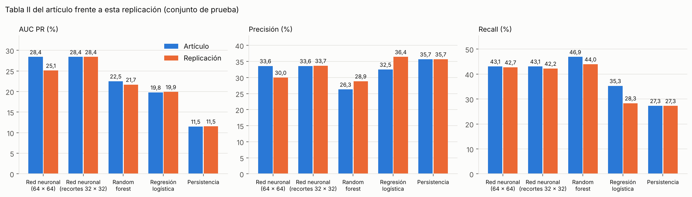
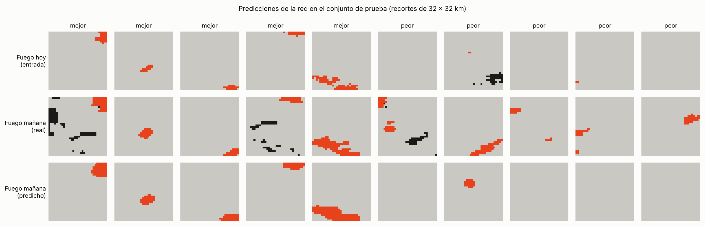
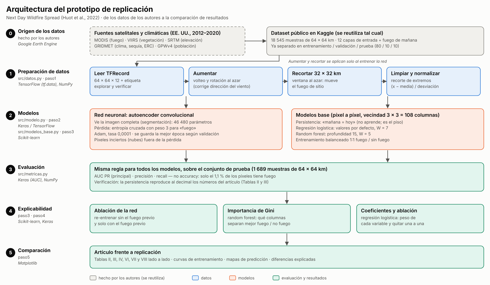
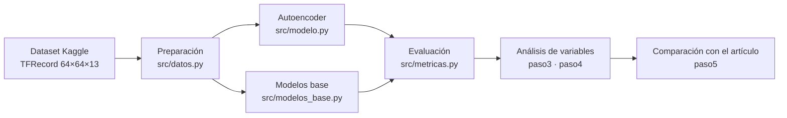

# Replicación de *Next Day Wildfire Spread* (Huot et al., 2022)

Replicación del flujo de entrenamiento y evaluación del artículo **"Next Day Wildfire Spread: A Machine Learning Dataset to Predict Wildfire Spreading From Remote-Sensing Data"** (IEEE Transactions on Geoscience and Remote Sensing, 2022). El objetivo es reproducir sus experimentos con el dataset que publicaron los autores y comparar los resultados obtenidos con los del artículo.


---

## Contenido

1. [Contexto](#contexto)
2. [Resultados principales](#resultados-principales)
3. [Workflow del artículo y alcance de la replicación](#workflow-del-artículo-y-alcance-de-la-replicación)
4. [Datos](#datos)
5. [Modelos](#modelos)
6. [Arquitectura del prototipo](#arquitectura-del-prototipo)
7. [Estructura del repositorio](#estructura-del-repositorio)
8. [Ejecución](#ejecución)
9. [Diferencias con el artículo](#diferencias-con-el-artículo)
10. [Limitaciones](#limitaciones)
11. [Autoría](#autoría)
12. [Referencias](#referencias)

---

## Contexto

Predecir hacia dónde se propagará un incendio forestal al día siguiente ayuda a decidir dónde desplegar brigadas, a quién evacuar y qué medidas preventivas tomar. Huot et al. (2022) publican un dataset abierto que combina, a 1 km de resolución, la máscara de fuego de dos días consecutivos con variables de topografía, clima, sequía, vegetación y población. Con ese dataset entrenan un autoencoder convolucional que predice la máscara de fuego del día *t* + 1 y lo comparan con tres modelos de referencia.

| | |
| --- | --- |
| **Artículo** | Huot, F., Hu, R. L., Goyal, N., Sankar, T., Ihme, M., & Chen, Y.-F. (2022). *IEEE TGRS*, 60, 4412513 |
| **DOI** | [10.1109/TGRS.2022.3192974](https://doi.org/10.1109/TGRS.2022.3192974) |
| **Dataset** | [kaggle.com/datasets/fantineh/next-day-wildfire-spread](https://www.kaggle.com/datasets/fantineh/next-day-wildfire-spread) |
| **Código de los autores** | [google-research/next_day_wildfire_spread](https://github.com/google-research/google-research/tree/master/simulation_research/next_day_wildfire_spread) |

Este repositorio forma parte de una propuesta de investigación sobre la **predicción de la propagación diaria de incendios forestales en el Perú con modelos ligeros**. Para ese trabajo, esta replicación sirve como línea base.

---

## Resultados principales

Conjunto de prueba (1 689 muestras). Las métricas están en porcentaje y en el formato **AUC PR / precisión / recall**.

| Modelo | Artículo (Tabla II) | Replicación: muestra completa 64 × 64 km | Replicación: recortes 32 × 32 km |
| --- | --- | --- | --- |
| Autoencoder convolucional | 28,4 / 33,6 / 43,1 | 25,1 / 30,0 / 42,7 | **28,4 / 33,7 / 42,2** |
| Random forest | 22,5 / 26,3 / 46,9 | 21,7 / 28,9 / 44,0 | — |
| Regresión logística | 19,8 / 32,5 / 35,3 | 19,9 / 36,4 / 28,3 | — |
| Persistencia | 11,5 / 35,7 / 27,3 | **11,5 / 35,7 / 27,3** | 14,3 / 40,1 / 26,4 |



**Hallazgos**

- **Se reproduce el orden de los modelos:** red neuronal > random forest > regresión logística > persistencia.
- **El protocolo de evaluación queda validado.** La persistencia no se entrena, así que su resultado depende solo de los datos y de cómo se mide. Reproduce al decimal la Tabla II y las tres filas de persistencia de la Tabla III (2, 4 y 8 km).
- **El valor de la red depende de los píxeles evaluados.** Sobre recortes de 32 × 32 km da 28,4, igual que el artículo. Sobre la muestra completa de 64 × 64 km, que es el protocolo con el que coinciden los modelos base, da 25,1. El artículo no indica sobre qué región evaluó la red. La hipótesis de que usó recortes para la red y la muestra completa para los modelos base es consistente con los números y con el código publicado, pero no está confirmada.
- **La máscara de fuego del día *t* es la variable decisiva.** Al quitarla, el AUC PR de la red cae a 6,9 (artículo: 6,8) y el de la regresión logística a 3,1 (artículo: 3,1). En el random forest, sus nueve posiciones de la vecindad ocupan los nueve primeros puestos de importancia de Gini, igual que en la Tabla VI.

### Análisis de variables

| Experimento | Artículo | Replicación (recortes 32 × 32 km) |
| --- | --- | --- |
| Red sin la máscara de fuego previa (Tabla IV) | 6,8 / 4,6 / 0,2 | 6,9 / 20,4 / 0,2 |
| Red solo con la máscara de fuego previa (Sección V-B) | 22,9 / 29,2 / 49,6 | 21,3 / 25,8 / 52,0 |

| Experimento (regresión logística, Tabla VIII) | Artículo (AUC PR) | Replicación (AUC PR) |
| --- | --- | --- |
| Sin la máscara de fuego previa | 3,1 | 3,1 |
| Sin cualquier otra variable | 19,6 – 20,0 | 19,8 – 20,0 |

### Predicciones de la red



En los mejores casos, la red ubica bien la zona del incendio y produce bordes más redondeados que los reales, como describe el artículo (Fig. 3). Falla cuando el fuego del día siguiente aparece en zonas sin fuego el día *t*. Los píxeles negros corresponden a etiquetas inciertas (nubes o datos sin procesar) y no entran en la métrica.

El detalle completo de todas las tablas está en [`resultados/comparacion_resultados.md`](resultados/comparacion_resultados.md).

---

## Workflow del artículo y alcance de la replicación

| # | Etapa del artículo | Replicación |
| --- | --- | --- |
| 1 | Agregación de datos en Google Earth Engine (MODIS, VIIRS, SRTM, GRIDMET, GPWv4) | No se ejecuta: se reutiliza el dataset publicado en Kaggle |
| 2 | Construcción de muestras de 64 × 64 km y partición 8:1:1 por semanas | Se usa la partición original y se verifican los conteos |
| 3 | Recorte de valores extremos y normalización | ✔ Con las constantes del código de los autores |
| 4 | Aumento de datos: recorte aleatorio de 32 × 32 km, volteo y rotación | ✔ |
| 5 | Autoencoder convolucional | ✔ |
| 6 | Entrenamiento con entropía cruzada ponderada | ✔ Con menos pasos (ver [Diferencias](#diferencias-con-el-artículo)) |
| 7 | Modelos base: persistencia, regresión logística, random forest | ✔ |
| 8 | Evaluación en el conjunto de prueba (Tabla II) | ✔ |
| 9 | Predicción a menor resolución (Tabla III) | Parcial: filas de persistencia |
| 10 | Ablación de la red (Tablas IV y V) | Parcial: sin la máscara de fuego previa y solo con ella |
| 11 | Importancia de Gini del random forest (Tabla VI) | ✔ |
| 12 | Coeficientes y ablación de la regresión logística (Tablas VII y VIII) | ✔ |
| 13 | Seis incendios históricos de 2020 | No: requiere exportar datos nuevos desde Earth Engine |

---

## Datos

El dataset contiene **18 545 muestras** de incendios en EE. UU. continental entre 2012 y 2020. Cada muestra es una región de 64 × 64 km a 1 km por píxel, con 12 canales de entrada y la máscara de fuego del día siguiente como etiqueta.

| Variable | Clave | Fuente | Resolución original |
| --- | --- | --- | --- |
| Elevación | `elevation` | SRTM | 30 m |
| Dirección y velocidad del viento | `th`, `vs` | GRIDMET | 4 km, diaria |
| Temperatura mínima y máxima | `tmmn`, `tmmx` | GRIDMET | 4 km, diaria |
| Humedad específica | `sph` | GRIDMET | 4 km, diaria |
| Precipitación | `pr` | GRIDMET | 4 km, diaria |
| Energy Release Component | `erc` | GRIDMET (NFDRS) | 4 km, diaria |
| Índice de sequía (PDSI) | `pdsi` | GRIDMET Drought | 4 km, cada 5 días |
| Vegetación (NDVI) | `NDVI` | VIIRS VNP13A1 | 500 m, cada 8 días |
| Densidad de población | `population` | GPWv4 | 1 km, cada 5 años |
| Fuego en *t* (entrada) | `PrevFireMask` | MODIS MOD14A1 V6 | 1 km, diaria |
| Fuego en *t* + 1 (etiqueta) | `FireMask` | MODIS MOD14A1 V6 | 1 km, diaria |

**Verificación realizada**

| Dato | Artículo | Replicación |
| --- | --- | --- |
| Muestras (entrenamiento / validación / prueba) | 18 545 | 18 545 (14 979 / 1 877 / 1 689) |
| El fuego crece de *t* a *t* + 1 | 10 798 (58 %) | 10 798 |
| El fuego decrece | 7 191 (39 %) | 7 191 |
| Píxeles con fuego / sin fuego / inciertos | — | 1,1 % / 96,5 % / 2,4 % |

Como menos del 1,2 % de los píxeles tiene fuego, la métrica principal es el **AUC PR** y no la *accuracy*.

---

## Modelos

**Autoencoder convolucional** (Sección IV y Apéndice A-A del artículo)

- Entrada de 32 × 32 × 12 y salida de 32 × 32 × 1 (logit de fuego por píxel). Por ser totalmente convolucional, también evalúa entradas de 64 × 64.
- Codificador con bloques residuales y *max pooling* (32 → 16 → 8) y decodificador simétrico con *upsampling* (8 → 16 → 32).
- Convoluciones de 3 × 3 con paso 1, *pooling* de 2 × 2, *dropout* de 0,1 y 16 o 32 filtros. En total, **46 480 parámetros**.
- Pérdida de entropía cruzada ponderada (peso 3 para la clase fuego). Los píxeles inciertos se excluyen de la pérdida y de las métricas.
- Optimizador Adam con tasa de aprendizaje de 0,0001. Se elige el modelo con mejor AUC PR en validación.

**Modelos base** (Apéndice A-B)

- **Persistencia:** predice que el fuego de mañana estará donde está hoy.
- **Regresión logística** y **random forest** (profundidad máxima 15), entrenados con Scikit-learn. Clasifican píxel por píxel a partir de una vecindad de 3 × 3 (9 píxeles × 12 variables = 108 columnas), con datos de entrenamiento balanceados 1:1 y peso de clase *W* = 7 (logística) y *W* = 5 (bosque).

---

## Arquitectura del prototipo





La arquitectura de la red se detalla en [`arquitectura/arquitectura_modelo.png`](arquitectura/arquitectura_modelo.png).

---

## Estructura del repositorio

```
.
├── README.md
├── PROCESO_REPLICACION.md                       documentación técnica detallada
├── replicacion_next_day_wildfire_spread.ipynb   flujo completo en un notebook (Kaggle / Colab)
├── requirements.txt
├── src/
│   ├── config.py           rutas, variables, constantes de normalización, hiperparámetros y cifras del artículo
│   ├── datos.py            lectura de TFRecord, aumento de datos, recorte y normalización
│   ├── modelo.py           autoencoder convolucional
│   ├── metricas.py         pérdida ponderada y métricas que ignoran píxeles inciertos
│   ├── entrenamiento.py    entrenamiento con reanudación automática y evaluación
│   ├── modelos_base.py     persistencia, regresión logística y random forest
│   └── graficos.py         figuras
├── paso1_explorar_datos.py          verificación del dataset
├── paso2_entrenar_red.py            entrenamiento y evaluación de la red
├── paso3_modelos_base.py            modelos base, coeficientes, ablación e importancia de Gini
├── paso4_ablacion_red.py            ablación de la red
├── paso5_comparar_con_articulo.py   tablas y figuras comparativas
├── extra_tasa_aprendizaje.py        experimento adicional (tasa de aprendizaje 10× mayor)
├── arquitectura/                    diagramas del prototipo y de la red
├── herramientas/                    scripts que generan el notebook y los diagramas
└── resultados/                      métricas (JSON), figuras, pesos entrenados y registros de ejecución
```

Cada constante de `src/config.py` indica su origen: `[ART]` texto del artículo, `[COD]` código de los autores y `[REP]` decisión de esta replicación.

---

## Ejecución

### Opción 1: Kaggle (recomendada)

1. Crea un notebook nuevo e importa `replicacion_next_day_wildfire_spread.ipynb` (*File → Import Notebook*).
2. *Add Input* → busca `next-day-wildfire-spread` (autor `fantineh`) → *Add*.
3. *Settings → Accelerator →* GPU.
4. *Run All*.

### Opción 2: Google Colab

Sube el notebook, activa la GPU en *Entorno de ejecución → Cambiar tipo de entorno* y ejecuta todas las celdas. El dataset (~2 GB) se descarga automáticamente con `kagglehub`. Es público y no requiere credenciales.

### Opción 3: Local

```bash
git clone https://github.com/<usuario>/<repositorio>.git
cd <repositorio>
pip install -r requirements.txt

python paso1_explorar_datos.py
python paso2_entrenar_red.py
python paso3_modelos_base.py
python paso4_ablacion_red.py
python paso5_comparar_con_articulo.py
```

### Configuración

| Variable de entorno | Uso |
| --- | --- |
| `WILDFIRE_PRESUPUESTO` | `prueba`, `prototipo` (por defecto) o `largo` |
| `WILDFIRE_DATOS` | Carpeta con los `.tfrecord` si ya están descargados. Si no se define, se busca en `datos/` o se descarga de Kaggle |

| Presupuesto | Épocas × pasos | Uso |
| --- | --- | --- |
| `prueba` | 2 × 20 | Comprobar que el flujo corre de principio a fin (~5 min). Sus métricas no son representativas y se guardan en `resultados_prueba/` |
| `prototipo` | 60 × 468 = 28 080 | Configuración de los resultados reportados (~1 h por entrenamiento en CPU) |
| `largo` | 300 × 468 = 140 400 | Entrenamiento más cercano al del artículo, recomendado con GPU |

Un entrenamiento interrumpido se reanuda desde la última época guardada. Para empezar de cero, borra `resultados/modelos/` y los archivos `resultados/historial_*.json`.

**Entorno usado para los resultados:** Python 3.13, TensorFlow 2.21, Keras 3.15, Scikit-learn 1.9 y NumPy 2.5, en una CPU de 4 núcleos sin GPU.

---

## Diferencias con el artículo

| Aspecto | Artículo | Replicación |
| --- | --- | --- |
| Región evaluada para la red | No especificada | Se reportan ambas: muestra completa y recortes de 32 × 32 km |
| Pasos de entrenamiento | 1 000 000 (1000 épocas × 1000 pasos) | 28 080 (2,8 %) |
| Hardware | 4 GPU NVIDIA V100 | CPU de 4 núcleos |
| Tamaño de lote | Búsqueda entre 32 y 256 | 32 |
| Búsqueda de hiperparámetros | En grilla | No se repite; se usan los valores finales publicados |
| Script de entrenamiento | No publicado | Reconstruido a partir del texto y del código disponible |
| Semilla | No reportada | 123, con una sola corrida |

La curva de validación se estabiliza cerca de la época 20. Un experimento adicional con una tasa de aprendizaje 10 veces mayor llegó a un resultado similar (28,0 sobre recortes), así que el menor número de pasos no parece ser la principal fuente de diferencia.

---

## Limitaciones

- Los resultados de la red provienen de **una sola semilla**, sin intervalos entre corridas.
- **No se replicaron:** la agregación en Earth Engine, la evaluación en los seis incendios históricos de 2020, las filas de la red en la Tabla III ni la ablación completa de las Tablas IV y V.
- **Los coeficientes de la regresión logística (Tabla VII) no se reproducen:** el AUC PR y la ablación coinciden, pero el orden de los coeficientes no. Una posible causa es la alta correlación entre píxeles vecinos.
- **La hipótesis sobre los dos protocolos de evaluación no está confirmada** con los autores.
- **Las constantes de normalización** del código publicado se calcularon sobre un conjunto mayor que el disponible en Kaggle. Se mantuvieron para replicar el modelo de los autores.

El análisis completo de diferencias y hallazgos está en [`PROCESO_REPLICACION.md`](PROCESO_REPLICACION.md).

---

## Autoría

**Rodrigo Stefano Quiroga Sanchez**
Carrera de Ingeniería de Sistemas, Facultad de Ingeniería, Universidad de Lima.
Curso: Propuesta de Investigación, 2026-2.

La implementación del código y la ejecución de los experimentos se realizaron con asistencia de **Claude Code** (Anthropic). La selección del artículo, la definición del alcance de la replicación, la revisión de los resultados y su interpretación son del autor.

---

## Referencias

Huot, F., Hu, R. L., Goyal, N., Sankar, T., Ihme, M., & Chen, Y.-F. (2022). Next Day Wildfire Spread: A machine learning dataset to predict wildfire spreading from remote-sensing data. *IEEE Transactions on Geoscience and Remote Sensing, 60*, 4412513. https://doi.org/10.1109/TGRS.2022.3192974

```bibtex
@article{huot2022nextday,
  title   = {Next Day Wildfire Spread: A Machine Learning Dataset to Predict Wildfire Spreading From Remote-Sensing Data},
  author  = {Huot, Fantine and Hu, R. Lily and Goyal, Nita and Sankar, Tharun and Ihme, Matthias and Chen, Yi-Fan},
  journal = {IEEE Transactions on Geoscience and Remote Sensing},
  volume  = {60},
  pages   = {1--13},
  year    = {2022},
  doi     = {10.1109/TGRS.2022.3192974}
}
```

**Créditos.** El dataset, la arquitectura de la red, las constantes de normalización y las funciones de pérdida y métricas siguen el trabajo y el código publicado por los autores en [google-research](https://github.com/google-research/google-research/tree/master/simulation_research/next_day_wildfire_spread), con licencia Apache 2.0. El artículo se publica bajo licencia CC BY 4.0.
